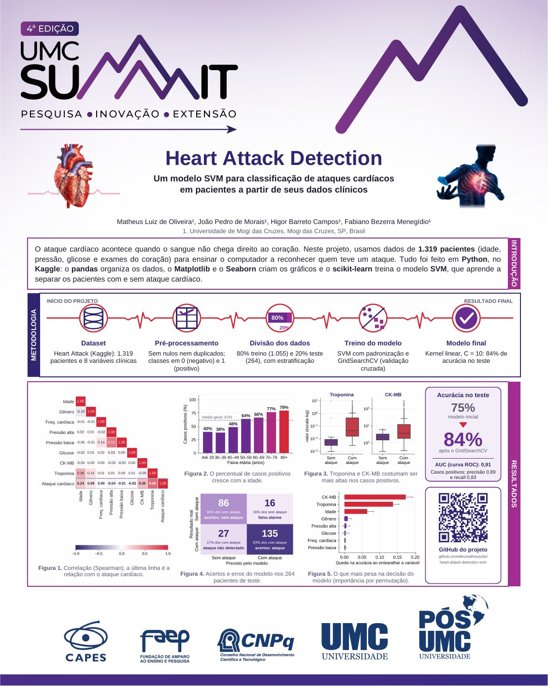
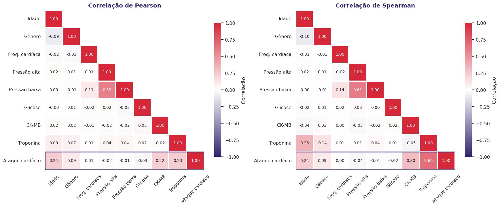
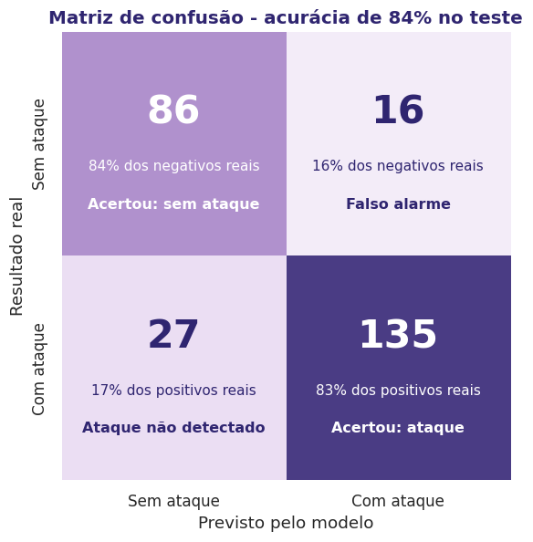
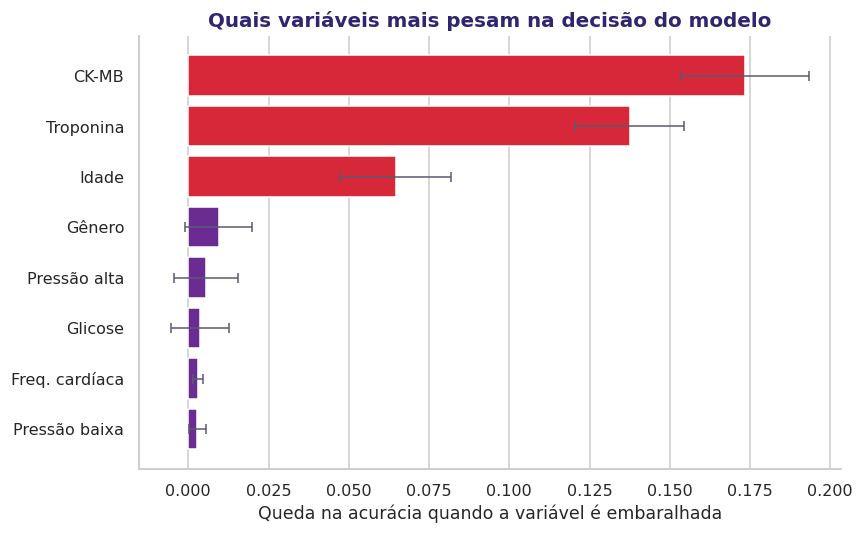

# Heart Attack Detection

**Classificação de ataques cardíacos em pacientes com SVM, a partir de dados clínicos.**

Projeto apresentado no **UMC Summit (4ª edição) - Pesquisa, Inovação e Extensão**, da Universidade de Mogi das Cruzes (UMC).



O pôster completo (80 x 100 cm) está em [`poster/poster_summit_heart_attack_80x100.pdf`](poster/poster_summit_heart_attack_80x100.pdf).

## Sobre o projeto

O ataque cardíaco acontece quando o sangue não chega direito ao coração. Neste projeto, usamos dados de **1.319 pacientes** (idade, gênero, frequência cardíaca, pressão arterial, glicose e exames do coração) para ensinar o computador a reconhecer quem teve um ataque cardíaco.

Para isso, treinamos um modelo **SVM (Support Vector Machine)**, um método que aprende a separar os pacientes com e sem ataque cardíaco.

## Ferramentas utilizadas

| Ferramenta | Para que foi usada |
|---|---|
| **Python 3** | Linguagem de todo o projeto |
| **Kaggle** | Ambiente onde o notebook foi desenvolvido |
| **pandas** e **NumPy** | Leitura e organização dos dados |
| **Matplotlib** e **Seaborn** | Criação dos gráficos |
| **scikit-learn** | Treino e avaliação do modelo SVM |

## Dataset

- **Nome:** An Extensive Dataset for the Heart Disease Classification System (Mendeley Data)
- **Tamanho:** 1.319 pacientes, 8 variáveis de entrada e 1 de saída (`class`: negative ou positive)
- **Licença:** CC BY 4.0
- A cópia usada no projeto está em [`data/Heart_Attack.csv`](data/Heart_Attack.csv). A descrição de cada coluna está em [`data/README.md`](data/README.md).

## Metodologia

1. **Dataset:** leitura do arquivo com 1.319 pacientes e 8 variáveis clínicas.
2. **Pré-processamento:** conferência de valores nulos e duplicados (não há nenhum) e codificação da classe em 0 (negativo) e 1 (positivo).
3. **Divisão dos dados:** 80% para treino (1.055 pacientes) e 20% para teste (264 pacientes), com estratificação e `random_state=42`.
4. **Treino do modelo:** `Pipeline` com `StandardScaler` e `SVC`. O modelo inicial usou kernel RBF e C = 1. Depois, o `GridSearchCV` (validação cruzada com 5 partes) testou kernel linear e RBF, C = 0,1 / 1 / 10 e gamma = scale / 0,01 / 0,1.
5. **Modelo final:** kernel linear com C = 10.

## Resultados

| Métrica | Valor |
|---|---|
| Acurácia do modelo inicial (teste) | 0,75 |
| Acurácia média na validação cruzada (modelo otimizado) | 0,81 |
| **Acurácia do modelo otimizado (teste)** | **0,84** |
| AUC (curva ROC) | 0,91 |

Dos 264 pacientes de teste, o modelo acertou 221. Foram 16 falsos alarmes (pacientes sem ataque classificados como positivos) e 27 ataques não detectados (pacientes com ataque classificados como negativos).

| Classe | Precisão | Recall | F1 |
|---|---|---|---|
| negative | 0,76 | 0,84 | 0,80 |
| positive | 0,89 | 0,83 | 0,86 |

**O que mais pesa na decisão do modelo** (importância por permutação): CK-MB (queda de 0,17 na acurácia), troponina (0,14) e idade (0,06). As demais variáveis quase não mudam o resultado.

**Correlação com o ataque cardíaco** (Spearman): troponina 0,66, CK-MB 0,30 e idade 0,24. Pressão, glicose e frequência cardíaca ficam perto de zero.

<p align="center">
  
</p>
<p align="center">
  
  
</p>

Todos os gráficos do notebook estão na pasta [`figures/`](figures/).

## Limitações

- Os 27 pacientes com ataque classificados como negativos mostram que o modelo precisa ser testado em uma base independente antes de qualquer uso prático.
- Este é um projeto **acadêmico**. O modelo não deve ser usado para diagnóstico médico.
- O dataset é uma única base de dados secundária, com 1.319 registros.
- A frequência cardíaca (`impluse`) tem 3 valores acima de 150 (o máximo é 1111), que não são plausíveis. Eles foram mantidos para não alterar o resultado original do modelo.

## Como executar

**No Kaggle:** crie um notebook, anexe o dataset e importe o arquivo `notebooks/heart_attack_svm.ipynb`.

**No Google Colab:** em uma célula, rode `!git clone https://github.com/devmatheusoliv/heart-attack-detection-svm.git` e depois `%cd heart-attack-detection-svm/notebooks`. Abra o notebook e execute as células.

**No seu computador:**

```bash
git clone https://github.com/devmatheusoliv/heart-attack-detection-svm.git
cd heart-attack-detection-svm
pip install -r requirements.txt
jupyter notebook notebooks/heart_attack_svm.ipynb
```

O notebook procura o CSV em `data/Heart_Attack.csv` e, se não encontrar, usa o caminho do dataset do Kaggle.

## Estrutura do repositório

```
heart-attack-detection-svm/
├── data/
│   ├── Heart_Attack.csv          # dataset (CC BY 4.0)
│   └── README.md                 # descrição das colunas e fonte
├── notebooks/
│   └── heart_attack_svm.ipynb    # análise, treino do SVM e gráficos
├── figures/                      # gráficos gerados pelo notebook
├── poster/                       # pôster do UMC Summit (PDF e prévia)
├── requirements.txt
├── LICENSE
└── README.md
```

## Autores

- Matheus Luiz de Oliveira
- João Pedro de Morais
- Higor Barreto Campos
- Fabiano Bezerra Menegídio

Universidade de Mogi das Cruzes, Mogi das Cruzes, SP, Brasil.

## Referência do dataset

Maghdid, S. S.; Rashid, T. A. (2022). *An Extensive Dataset for the Heart Disease Classification System*. Mendeley Data, V2. DOI: [10.17632/65gxgy2nmg.2](https://doi.org/10.17632/65gxgy2nmg.2)

## Licença

O código e o texto deste repositório estão sob a licença MIT (veja [`LICENSE`](LICENSE)). O dataset mantém a licença original CC BY 4.0, dos autores citados acima.
